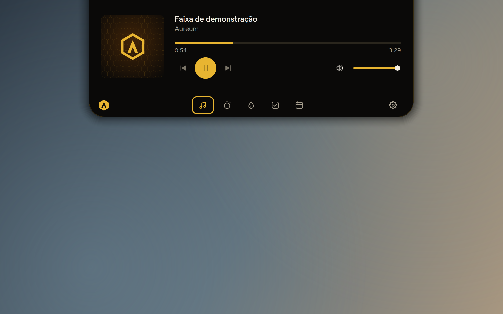

<p align="center">
  
</p>

<h1 align="center">Aureum Island</h1>

<p align="center">
  A borda da tela, viva.<br>
  <a href="https://eduoliveira1504.github.io/aureum-island/"><b>eduoliveira1504.github.io/aureum-island</b></a>
</p>



O Aureum Island é um notch pro topo da tela do Windows 10 e 11. Ele abre quando o mouse chega
(ou com **Ctrl+Alt+I**), some quando você sai e fica fora do caminho no jogo e no vídeo em tela
cheia:

- **Música:** capa, faixa e progresso do que estiver tocando no Spotify, no navegador ou no Media
  Player, com anterior, play/pausa, próxima e o volume do sistema.
- **Foco:** pomodoro com ciclos de foco e pausa, e aviso no fim de cada fase.
- **Água:** meta do dia, um clique por copo, lembrete no intervalo que você escolher e um mini
  gráfico por horário.
- **Tarefas:** lista rápida com horário e aviso na hora, com "+10 min" e "Feito".
- **Calendário:** o mês e a agenda de hoje juntos, com eventos criados no app e agendas do Google e
  do Outlook pelo link ICS (inclusive os que se repetem).
- **Avisos:** chegam no próprio notch, sem pular na frente do que você está fazendo. Em tela cheia,
  eles esperam você sair.
- **Do seu jeito:** atalho, iniciar com o Windows, linha mínima pra telas com borda grossa, tema da
  janela de configurações e cor de destaque.

Grátis, sem conta e sem telemetria. Tudo fica no seu computador. A única coisa que o app busca na
internet são os links ICS que você colar, e esses links ficam guardados no cofre do Windows.

## Como instalar

1. **Baixe o instalador** na [página do Aureum Island](https://eduoliveira1504.github.io/aureum-island/)
   ou nas [releases](https://github.com/eduoliveira1504/aureum-island/releases). Ele não pede senha
   de administrador.
2. **Libere no Windows.** O app ainda não tem assinatura digital, então o Windows avisa: clique em
   **Mais informações** e depois em **Executar assim mesmo**.
3. **Abra e pronto.** O notch fica no topo da tela. Na engrenagem dá pra ligar o **Iniciar com o
   Windows**.

O app não se atualiza sozinho: pra pegar uma versão nova, baixe de novo pela página e instale por
cima. Seus dados continuam. As novidades de cada versão ficam no [CHANGELOG](CHANGELOG.md).

Na desinstalação, o Windows pergunta antes de apagar os seus dados, os links de agenda e a opção de
iniciar com o Windows. Se você responder Não, eles ficam pra próxima instalação.

Achou um problema? [Abra uma issue](https://github.com/eduoliveira1504/aureum-island/issues/new).

## Pra quem desenvolve

Python 3.13 + PySide6, só Windows. Na raiz do repo, no PowerShell:

```powershell
python -m venv .venv
.venv\Scripts\python -m pip install -e ".[dev]"
.venv\Scripts\python -m aureum_island          # rodar
.venv\Scripts\python -m pytest                 # testes
.venv\Scripts\ruff check .                     # lint
.venv\Scripts\python scripts\build.py          # instalador (precisa do Inno Setup 6)
```

O visual fica em [docs/DESIGN.md](docs/DESIGN.md), as fases em [docs/ROADMAP.md](docs/ROADMAP.md)
e as decisões de projeto em [docs/decisions](docs/decisions). Licenças das fontes, ícones e sons:
[LICENSES.md](LICENSES.md).

---

## In English

**Aureum Island** is a "dynamic island" for Windows 10 and 11: a notch at the top of the screen
that opens on hover (or **Ctrl+Alt+I**) with now playing media and volume, a focus timer, water
tracking, tasks, and a calendar that reads Google and Outlook ICS links. Reminders show up in the
notch itself and wait while you're in full screen. Free, no account and no telemetry: everything
stays on your computer, and the only network calls are the ICS links you add.

It's built with Python 3.13 + PySide6 (Qt), uses the `winrt-*` packages for media controls, stores
data locally in SQLite and JSON, and keeps calendar links in the Windows Credential Manager. The
installer is PyInstaller (one folder) + Inno Setup, per user, no admin needed.

- Landing page: [eduoliveira1504.github.io/aureum-island](https://eduoliveira1504.github.io/aureum-island/)
- Design tokens: [docs/DESIGN.md](docs/DESIGN.md)
- Architecture decision records: [docs/decisions](docs/decisions)
